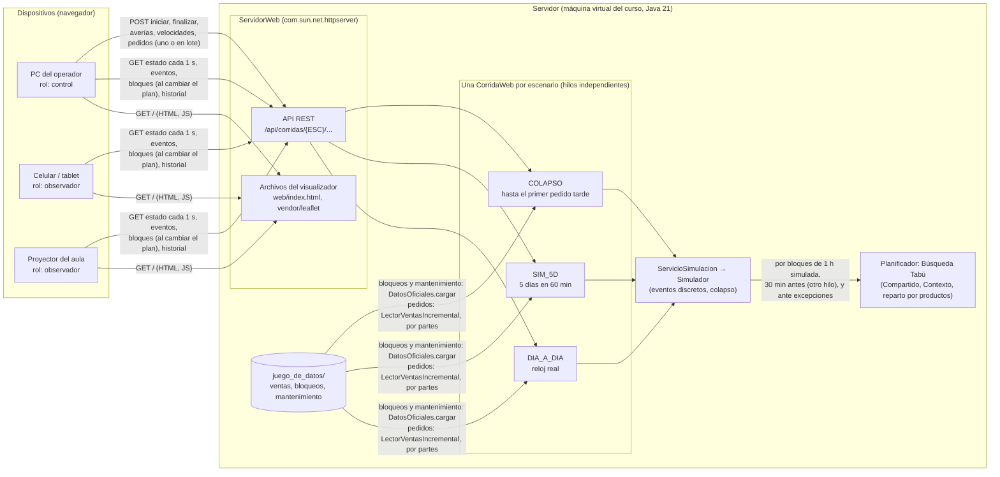

# Interacción entre el Planificador y el Visualizador (etapa 32)

La solución integrada tiene **dos componentes** que se comunican **solo por una API HTTP**:

- **Planificador** (Java, `ServidorWeb`): carga los datos oficiales, simula y planifica con Búsqueda Tabú. Corre una simulación por escenario, en su propio hilo, y guarda el estado en memoria.
- **Visualizador** (HTML + JavaScript, `web/index.html`): dibuja el estado y envía comandos. **No simula nada**: todo lo que muestra viene del planificador.

Cualquier dispositivo con un navegador puede abrir el visualizador y ver cualquiera de los tres escenarios. Todos los dispositivos ven **la misma corrida**, porque el estado vive en el planificador.

## 1. Componentes y despliegue



## 2. Secuencia de una corrida

```mermaid
sequenceDiagram
    autonumber
    actor Op as Operador (rol control)
    participant V as Visualizador (navegador)
    participant API as ServidorWeb (API REST)
    participant C as CorridaWeb (escenario)
    participant S as Simulador (hilo propio)
    participant T as Búsqueda Tabú
    actor Obs as Otro dispositivo (observador)

    Op->>V: Elige escenario, fecha de inicio, ritmo y flota
    V->>API: POST /api/corridas/SIM_5D (inicio, factor, flota)
    API->>C: CorridaWeb.iniciar(...)
    C->>C: DatosOficiales.cargar(mes, inicio, horizonte, sin pedidos) + LectorVentasIncremental
    C->>S: ServicioSimulacion.iniciar() (nuevo hilo)
    API-->>V: 200 {corrida, estado}

    loop Cada bloque de 1 h simulada (etapa 33, SI-30)
        S->>S: corte (30 min antes del bloque): lee los pedidos hasta el corte, copia el estado y la avanza hasta el inicio del bloque
        S-)T: planificar(estado proyectado, plan vigente, Ta del bloque) en otro hilo
        Note over S: el reloj sigue avanzando (Reloj.escalado)
        T--)S: rutas por unidad (productos repartidos)
        S->>S: inicio del bloque: si el estado real coincide, aplica el plan e inserta los pedidos llegados después del corte
    end
    opt Avería o pedido urgente (corta el bloque)
        S->>S: descarta el plan adelantado; el reloj se pausa (SI-32)
        S->>T: planificar(estado real, Ta = 2 s) en el instante
    end

    par Cada segundo, en cada dispositivo
        V->>API: GET /api/corridas/SIM_5D/estado
        API->>S: instantaneaJson() (con cerrojo)
        S-->>V: reloj, unidades, rutas, pedidos, bloqueos, indicadores
        V->>API: GET /api/corridas/SIM_5D/eventos?desde=n
        API-->>V: eventos nuevos (bitácora)
        opt Cambió plan.version (etapa 35)
            V->>API: GET /api/corridas/SIM_5D/bloques
            API-->>V: trayectorias nodo a nodo del bloque en curso y del siguiente
        end
    and
        Obs->>API: GET /api/corridas/SIM_5D/estado
        API-->>Obs: la misma instantánea
    end

    opt Evento externo (rol control)
        Op->>V: Registra avería / cambia velocidad / registra pedido (día a día)
        V->>API: POST /api/corridas/{ESC}/averias | velocidades | pedidos
        API->>S: inyectarAveria / cambiarVelocidad / inyectarPedido o programarPedido
        S->>T: avería o pedido urgente: replanificación inmediata; pedido normal: bloque siguiente (SI-35)
    end

    alt Un producto supera su hora límite
        S-->>API: estado COLAPSO (la corrida termina)
    else Se cumple el horizonte (5 días), se finaliza o se cierran las operaciones (día a día)
        S-->>API: estado FINALIZADA
    end
    V->>API: GET /api/corridas/{ESC}/reporte
    API-->>V: resumen por tipo de unidad y última planificación estable (cada parada con su hora)
```

## 3. Contrato de la API

| Método y ruta | Datos | Respuesta |
|---|---|---|
| `GET /api/datos` | — | meses con datos oficiales (`desde`, `hasta`) |
| `GET /api/corridas` | — | estado de las tres corridas (para las pestañas) |
| `POST /api/corridas/{ESC}` | `inicio=aaaa-mm-ddThh:mm`, `inicio_ms`, `factor`, `autos`, `motos`, `bicicletas` | `{corrida, estado}`; 409 si ya hay una en ejecución |
| `GET /api/corridas/{ESC}/estado` | — | `{corrida, estado}`: la instantánea completa |
| `GET /api/corridas/{ESC}/eventos?desde=n` | — | `{total, eventos[]}` desde el evento n |
| `GET /api/corridas/{ESC}/bloques` | — | trayectorias nodo a nodo (salida, llegada, x, y) del bloque en curso y del siguiente, con `plan.version` (etapa 35) |
| `GET /api/corridas/{ESC}/historial?id=X` | — | escalas y tramos recorridos de un pedido, parte o producto (`X·pN`); 404 si no existe (etapa 35) |
| `GET /api/corridas/{ESC}/reporte` | — | resumen por tipo de unidad y última planificación estable (`plan`: cada parada con su hora estimada) |
| `POST /api/corridas/{ESC}/finalizacion` | — | detiene la corrida |
| `POST /api/corridas/{ESC}/averias` | `unidad`, `tipo` (1, 2 o 3) | avería en el instante actual |
| `POST /api/corridas/{ESC}/velocidades` | `tipo`, `kmh` | rige desde la siguiente replanificación |
| `POST /api/corridas/DIA_A_DIA/pedidos` | `cliente`, `x`, `y`, `cantidad`, `plazo` | `{id, registro_min, limite_min}` |
| `POST /api/corridas/DIA_A_DIA/pedidos/lote` | `texto`: líneas `##d##h##m:x,y,cliente,cantidad,plazo` | cada línea registrada en su fecha y hora, o rechazada con su motivo (etapa 35) |

`{ESC}` es `SIM_5D`, `COLAPSO` o `DIA_A_DIA`. Los datos de entrada van como formulario (`application/x-www-form-urlencoded`) y las respuestas son JSON. La API permite CORS, así que el visualizador también puede alojarse en otro dominio (`index.html?api=https://servidor`).

## 4. Decisiones de diseño

- **Consulta periódica (1 s) en lugar de WebSocket** (opción B de `docs/propuesta_arquitectura_integracion.md`): es lo más simple de construir y explicar, funciona detrás de cualquier proxy y no necesita librerías. La instantánea es completa, no incremental, así que un dispositivo que se conecta tarde ve todo en el siguiente segundo.
- **El visualizador reproduce las trayectorias del bloque** (etapa 35): pide `…/bloques` cuando cambia el plan y mueve cada unidad nodo a nodo con las horas del plan, con su propio reloj, que no retrocede ni salta. Mientras la simulación espera al planificador, el reloj se pausa (SI-32). Antes interpolaba entre dos instantáneas y había saltos.
- **Cada navegador es independiente** (C06, G06): la selección, los filtros, el orden y la búsqueda son locales; solo las acciones (iniciar, finalizar, averías, pedidos) cambian lo que ven todos.
- **Un hilo por escenario:** desde la etapa 24 los algoritmos no tienen estado estático, así que las tres corridas pueden ir a la vez en el mismo proceso.
- **Rol de control u observador:** cualquier dispositivo puede mirar; solo el que tiene el rol de control muestra los botones de comandos. Para esta entrega el rol se elige en el navegador, sin autenticación.
